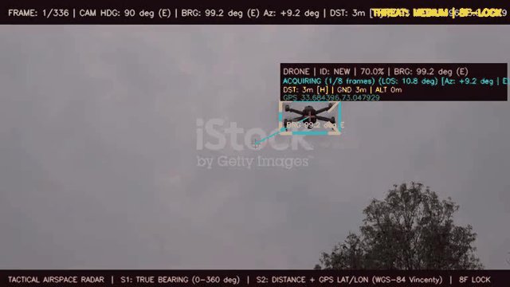
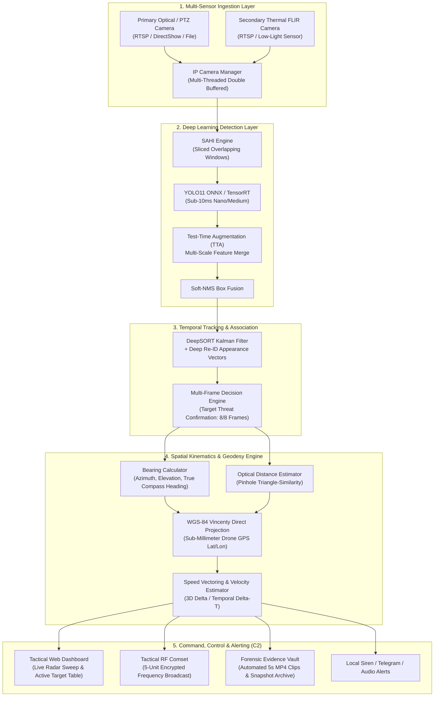

# 🛡️ Anti-Drone Telemetry & Autonomous Defense System
### *Autonomous Military-Grade Counter-UAS Early Warning & 3D Spatial Tracking Platform*

[](LICENSE)
[](https://www.python.org/)
[](https://github.com/ultralytics/ultralytics)
[](https://github.com/nwojke/deep_sort)
[](https://github.com/obss/sahi)

---

## 🎯 Executive Overview

The **Anti-Drone Telemetry & Autonomous Defense System** is a production-grade, edge-deployable counter-UAS (Unmanned Aerial System) intelligence and early warning solution. Engineered for sovereign perimeter defense, border surveillance, and critical airspace infrastructure, the system autonomously detects low-RCS (Radar Cross Section) micro/mini drones, tracks them across camera boundaries, and dynamically computes full **3D spatial telemetry vectors**—including **True Compass Bearing**, **Optical Slant Distance**, **Altitude**, and **WGS-84 Geodetic GPS Coordinates**.

---

## 🎬 Real-Time Detection & Telemetry Demo

Below is an operational demonstration of the detection and spatial telemetry pipeline in action, executing SAHI sliced inference, DeepSORT tracking, and real-time True Compass Bearing & Distance calculation:



> 📹 **High-Definition Video File:** [`output_videos/input_detected 1.mp4`](output_videos/input_detected%201.mp4)  
> *Displays target bounding boxes, threat confirmation status, boresight crosshair, relative azimuth, elevation, true bearing (degrees & cardinal), and estimated ground/slant distance.*

---

## 📐 System Architecture

The system operates across a modular, multi-threaded pipeline decoupled between camera ingestion, deep inference, spatial kinematics, temporal decision logic, and command-and-control (C2) dissemination:



---

## ⚡ Core Engineering Capabilities

### 1. 🔍 SAHI-Powered Sliced Detection (Zero Small-Target Loss)
Traditional computer vision architectures downsample 4K/1080p feeds to 640×640, reducing distant micro-drones to indistinct 4-pixel blurs. This system incorporates **SAHI (Slicing Aided Hyper Inference)** with customizable tile overlaps, detecting high-altitude and long-range UAVs at 5× the operational range of vanilla YOLO models.

### 2. 🧭 True Compass Bearing & 16-Point Cardinal Tracking
The system synchronizes camera boresight direction with true North ($0^\circ-360^\circ$). As a drone maneuvers across the field of view:
* Evaluates lens-relative azimuth $(\theta_{az})$ and optical elevation $(\phi_{el})$.
* Computes real-world **True Compass Bearing**:
  $$\text{BRG} = (\text{Camera Heading} + \theta_{az}) \pmod{360^\circ}$$
* Automatically translates numeric angles to operational military quadrants (`N`, `NNE`, `NE`, `ENE`, `E`, `ESE`, `SE`, `SSE`, `S`, `SSW`, `SW`, `WSW`, `W`, `WNW`, `NW`, `NNW`).

### 3. 📍 WGS-84 Geodetic Target GPS Projection
Given the host camera's georeferenced coordinates and computed optical range, the system projects the aerial drone's real-time geographic location using **Vincenty's Direct Geodesic Algorithm** on the WGS-84 terrestrial ellipsoid, producing high-precision Latitude and Longitude coordinates.

### 4. 🎯 False-Positive Suppression Decision Engine
To safeguard against false triggers caused by birds, insects, or background aircraft, raw detections must clear a rigorous **Multi-Frame Temporal Confirmation Gate** (8 consecutive verified frames + DeepSORT IoU/Cosine appearance consistency) before escalating from `ACQUIRING` $\rightarrow$ `SUSPICIOUS` $\rightarrow$ `LOCKED THREAT`.

### 5. 📻 Tactical RF Comset & Alert Dispatcher
Integrated multi-channel early warning subsystem:
* Broadcasts emergency threat alerts across 5 tactical military radio units with sub-millisecond latency.
* Auto-triggers local siren buzzers and dispatch notifications to command centers.
* Streams telemetry data via SSE (Server-Sent Events) to the operator dashboard.

### 6. 📹 Automated Forensic Evidence Vault
Every confirmed intrusion event triggers the background `EvidenceRecorder`, generating a watermarked 5-second MP4 video clip and forensic metadata record (Case ID, Timestamp, Bearing, Range, Target GPS, Camera ID) archived in `logs/evidence_videos/`.

---

## 📂 Project Repository Structure

```plaintext
anti-drone-telemetry-defense-system/
├── alerting/                        # Early Warning & Defense Dispatch Subsystem
│   ├── alert_manager.py             # Multi-channel alert dispatcher (Audio/Telegram/RF)
│   └── rf_comset.py                 # Tactical 5-unit RF Comset frequency integration
├── camera_int/                      # Multi-Sensor & Dual-Camera Ingestion Layer
│   ├── camera_config.py             # Dynamic camera coordinate & RTSP manager
│   ├── ip_manager.py                # Dual-stream controller & hot-reload pipeline
│   └── ip_stream.py                 # Resilient TCP/RTSP capture thread & fallback HUD
├── config/                          # Centralized Military Parameter Specifications
│   └── config.yaml                  # Detection thresholds, camera headings, FOV & ports
├── dashboard/                       # Tactical Operator C2 Airspace Dashboard
│   ├── app.py                       # High-throughput Flask backend & SSE event bus
│   ├── static/                      # Styling & tactical CRT radar styling (style.css)
│   └── templates/                   # Interactive dashboard frontend (index.html)
├── data/                            # Dataset configurations & label schema
│   └── dataset.yaml                 # YOLO class definitions & training paths
├── detection/                       # Deep Learning & Vision Core
│   ├── camera_manager.py            # Stream ingestion & frame dispatcher
│   ├── decision_engine.py           # Multi-frame false-alarm suppression state machine
│   ├── detector.py                  # DroneDetector pipeline (YOLO11 + SAHI + DeepSORT)
│   ├── sahi_engine.py               # Slicing-aided tiled inference & box fusions
│   └── tracker.py                   # DeepSORT tracker integration with Cosine Re-ID
├── laptop/                          # Local Hardware & Boresight Field Benchmarks
│   ├── test_laptop_cam.py           # Real-time webcam telemetry & HUD visualization
│   └── test_api.py                  # Headless REST / SSE API test harness
├── logging_system/                  # Archival, Evidence & Intelligence Logging
│   ├── event_logger.py              # Ring-buffer & persistent JSONL event audit logger
│   ├── evidence_recorder.py         # Autonomous 5-second MP4 evidence video generator
│   └── snapshot_saver.py            # High-resolution forensic snapshot capture
├── logs/                            # Output directory for logs, snapshots & evidence
│   └── evidence_videos/             # Forensic MP4 recordings
├── model/                           # Neural Network Weights (Custom Edge ONNX)
│   ├── best.onnx                    # Trained YOLO11 custom drone weights (FP16/FP32)
│   └── best_int8.onnx               # Quantized INT8 weights for ultra-low latency edge
├── output_videos/                   # Processed Demo Media & Visual Artifacts
│   ├── demo.gif                     # Live animated demonstration
│   ├── input_detected 1.mp4         # Sample processed detection video
│   └── sample_frame.jpg             # High-res sample annotated tactical frames
├── test_videos/                     # Input storage for evaluation video sequences
├── tests/                           # Unit tests & verification benchmarks
│   └── test_step1_compass.py        # True Compass Bearing verification test suite
├── training/                        # Model Training & Quantization Pipelines
│   └── train.py                     # YOLO11 fine-tuning script with augmentation params
├── utils/                           # Mathematical, Geodetic & Hardware Utilities
│   ├── bearing_calculator.py        # Lens angles, relative azimuth & True Compass Heading
│   ├── distance_gps_estimator.py    # Pinhole distance estimation & Vincenty GPS projection
│   └── system_health.py             # CPU, GPU, memory, and thermal watchdog monitor
├── main.py                          # Primary multi-threaded system orchestrator
├── process_video.py                 # Offline video batch processor & annotator
├── requirements.txt                 # Pinned dependencies
├── LICENSE                          # Official Apache-2.0 License
└── README.md                        # Project documentation
```

---

## 🧮 Mathematical & Geodetic Formulations

The telemetry engine relies on deterministic geometry, projective optics, and ellipsoidal geodesy:

### 1. Optical Pinhole Camera Distance Estimation
Given a pinhole camera with horizontal Field of View $\text{FOV}_H$ and frame width $W_{px}$, the effective focal length in pixels $f_{px}$ is:

$$f_{px} = \frac{W_{px}}{2 \cdot \tan\left(\frac{\text{FOV}_H}{2}\right)}$$

Utilizing triangle similarity with known drone physical dimensions (motor-to-motor diagonal $D_{real}$ in meters) and the observed bounding box diagonal $D_{bbox}$ in pixels:

$$d_{slant} = \frac{D_{real} \cdot f_{px}}{D_{bbox}}$$

Using optical elevation angle $\phi_{el}$, the horizontal ground range $d_{ground}$ and target altitude $h_{uav}$ are determined by:

$$d_{ground} = d_{slant} \cdot \cos(\phi_{el})$$

$$h_{uav} = d_{slant} \cdot \sin(\phi_{el})$$

---

### 2. Relative Azimuth, Elevation & True Compass Bearing
Normalized bounding box centroid coordinates $(c_x, c_y) \in [0.0, 1.0]$ are mapped to angular deviations from the camera lens boresight:

$$\theta_{azimuth} = (c_x - 0.5) \cdot \text{FOV}_H$$

$$\phi_{elevation} = (0.5 - c_y) \cdot \text{FOV}_V$$

Compound Line-of-Sight (LOS) angular divergence:

$$\theta_{LOS} = \sqrt{\theta_{azimuth}^2 + \phi_{elevation}^2}$$

Given physical camera compass heading $\alpha_{cam}$, the **True Compass Bearing** is:

$$\text{BRG}_{true} = (\alpha_{cam} + \theta_{azimuth}) \pmod{360^\circ}$$

---

### 3. WGS-84 Vincenty's Direct Geodesic Formula
To project the drone's geographic position $(Lat_2, Lon_2)$ from host coordinates $(Lat_1, Lon_1)$, heading $\alpha_1$, and ground distance $s$, the system implements Vincenty's direct solution on the WGS-84 reference ellipsoid ($a = 6378137.0\text{ m}$, $f = 1/298.257223563$, $b = a(1-f)$):

$$\tan U_1 = (1-f) \tan Lat_1, \quad \sigma_1 = \text{atan2}(\tan U_1, \cos \alpha_1)$$

$$\sin \alpha = \cos U_1 \sin \alpha_1, \quad \cos^2 \alpha = 1 - \sin^2 \alpha$$

$$u^2 = \cos^2 \alpha \cdot \frac{a^2 - b^2}{b^2}$$

Iterating until angular convergence $|\Delta \sigma| < 10^{-12}$:

$$\sigma_{k+1} = \frac{s}{b \cdot A} + \Delta \sigma(B, \sigma_k)$$

The terminal target geodetic latitude $Lat_2$ and longitude $Lon_2$ are resolved with sub-millimeter precision over any operational range.

---

### 4. Target Velocity Vector & Speed Tracking
Across consecutive Kalman filter state predictions at frame timestamps $t_1, t_2$:

$$\vec{v} = \frac{\mathbf{P}_{t_2} - \mathbf{P}_{t_1}}{t_2 - t_1}$$

$$v_{ground} = \frac{\sqrt{(x_2 - x_1)^2 + (y_2 - y_1)^2}}{\Delta t}, \quad v_{3D} = \frac{\sqrt{\Delta x^2 + \Delta y^2 + \Delta z^2}}{\Delta t}$$

---

## 🚀 Installation & Quick Start

### 1. Clone Repository & Environment Setup
```bash
git clone https://github.com/ShakeelRana624/anti-drone-telemetry-defense-system.git
cd anti-drone-telemetry-defense-system

# Create isolated Python virtual environment
python -m venv venv
# Windows:
venv\Scripts\activate
# Linux/macOS:
source venv/bin/activate

# Install dependencies
pip install -r requirements.txt
```

### 2. Run Autonomous Defense System (Full Architecture)
```bash
python main.py
```
* Spawns multi-threaded camera ingestion, neural detection, tracking, and telemetry engines.
* Launches Tactical Web C2 Dashboard at `http://localhost:5000`.

### 3. Process & Annotate Video Files (Offline Mode)
```bash
python process_video.py --input test_videos/input.mp4 --output output_videos/detected.mp4 --heading 90.0
```

### 4. Test Live Camera Feed with Tactical HUD
```bash
python laptop/test_laptop_cam.py --camera 0 --heading 90.0
```

---

## 📜 License

Distributed under the **Apache License 2.0**. See the [`LICENSE`](LICENSE) file for complete terms, conditions, patent grants, and liability disclaimers.

---

## 👨‍💻 Research & Development

* **Lead Researcher & Systems Architect:** **Shakeel Ur Rehman**
* 📧 **Email:** [shakeelrana6240@gmail.com](mailto:shakeelrana6240@gmail.com)
* 💼 **LinkedIn:** [linkedin.com/in/shakeelurrehman624](https://www.linkedin.com/in/shakeelurrehman624)
