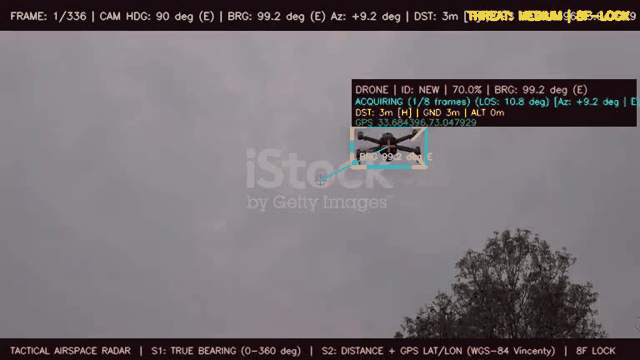
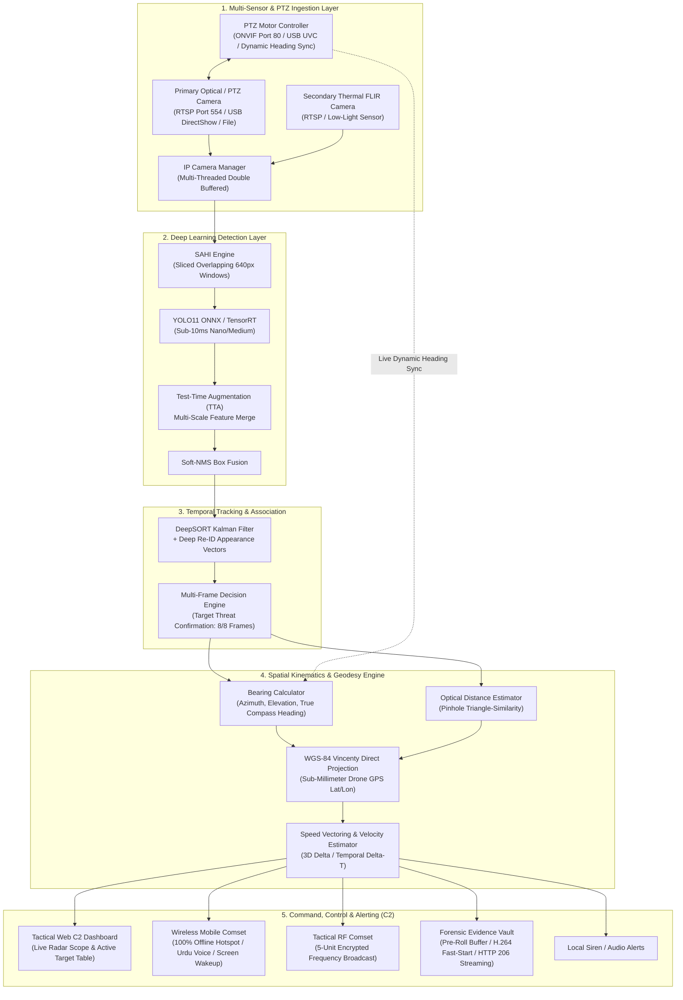

# 🛡️ Anti-Drone Telemetry & Autonomous Defense System
### *Autonomous Military-Grade Counter-UAS Early Warning, 3D Spatial Tracking & Mobile C2 Platform*

[](LICENSE)
[](https://www.python.org/)
[](https://github.com/ultralytics/ultralytics)
[](https://github.com/nwojke/deep_sort)
[](https://github.com/obss/sahi)
[](#2--tactical-ptz-motorized-camera-control--dynamic-compass-sync)
[](#3--wireless-mobile-tactical-alerting--urdu-voice-c2)
[](#3--wireless-mobile-tactical-alerting--urdu-voice-c2)

---

## 🎯 Executive Overview

The **Anti-Drone Telemetry & Autonomous Defense System** is a production-grade, edge-deployable counter-UAS (Unmanned Aerial System) intelligence, spatial tracking, and early warning solution. Engineered for sovereign perimeter defense, border surveillance, and critical airspace infrastructure, the system autonomously detects low-RCS (Radar Cross Section) micro/mini drones, tracks them across camera boundaries, and dynamically computes full **3D spatial telemetry vectors**—including **True Compass Bearing**, **Optical Slant Distance**, **Altitude**, and **WGS-84 Geodetic GPS Coordinates**.

The platform features an integrated **Motorized PTZ (Pan-Tilt-Zoom) Camera Subsystem with Dynamic Compass Angle Tracking**, a **100% Offline Mobile Tactical Early Warning System with Urdu Voice Warnings**, and an automated **Continuous Forensic Evidence Vault with Pre-Roll Buffering & Universal H.264 Fast-Start Web Streaming**.

---

## 🎬 Real-Time Detection & Telemetry Demo

Below is an operational demonstration of the detection and spatial telemetry pipeline in action, executing SAHI sliced inference, DeepSORT tracking, and real-time True Compass Bearing & Distance calculation:



> 📹 **High-Definition Video File:** [`output_videos/input_detected 1.mp4`](output_videos/input_detected%201.mp4)  
> *Displays target bounding boxes, threat confirmation status, boresight crosshair, relative azimuth, elevation, true bearing (degrees & cardinal), and estimated ground/slant distance.*

---

## 📐 System Architecture

The system operates across a modular, multi-threaded pipeline decoupled between camera ingestion, deep inference, spatial kinematics, temporal decision logic, motorized PTZ tracking, and command-and-control (C2) dissemination:



---

## ⚡ Core Engineering Capabilities

### 1. 🔍 SAHI-Powered Sliced Detection (Zero Small-Target Loss)
Traditional computer vision architectures downsample 4K/1080p feeds to 640×640, reducing distant micro-drones to indistinct 4-pixel blurs. This system incorporates **SAHI (Slicing Aided Hyper Inference)** with customizable tile overlaps, detecting high-altitude and long-range UAVs at 5× the operational range of vanilla YOLO models.

### 2. 🔄 Tactical PTZ Motorized Camera Control & Dynamic Compass Sync
Engineered for both **Network IP PTZ (ONVIF Profile S/T)** and **USB-Connected PTZ Webcams (UVC DirectShow)**:
* **Dynamic Bearing Synchronization:** As the camera rotates or zooms, the system calculates drone positions from:
  $$\text{Live Heading} = (\text{Mount Base Heading} + \text{Pan Motor Angle}) \pmod{360^\circ}$$
  Drone compass bearings, radar sweep needles, and GPS target positions adjust in real-time with zero manual typing.
* **Dual-Port Network Architecture:** Isolates RTSP video streaming (`Port 554`) from ONVIF motor controls (`Port 80`), eliminating socket collisions and interface timeouts.
* **Tactical Joystick & Nudge Pad:** On-screen D-Pad, 1-click cardinal sector pills (`NORTH`, `EAST`, `SOUTH`, `WEST`), and hardware **Keyboard Arrow Key shortcuts (`←`, `→`, `↑`, `↓`)** for seamless operator control.

### 3. 📱 Wireless Mobile Tactical Alerting & Urdu Voice C2
Field-tested for operating in forward, remote environments without internet access:
* **100% Offline Hotspot Support:** Runs over local Wi-Fi or Windows Mobile Hotspot without requiring cellular data, SIM cards, or cloud connections.
* **Wireless ADB Orchestrator (`alerting/mobile_comset.py`):** Wirelessly pairs with Android 11+ smartphones via pairing code and auto-detects ADB ports.
* **Automated Screen Wakeup & Chrome Launch:** On confirmed threat incursion, the system sends a high-priority ADB keyevent to wake up the phone, unlock the screen, and launch the tactical alert interface in Chrome.
* **Bilingual Urdu Voice Warning & Strobe Display:** Triggers a high-intensity full-screen red warning strobe accompanied by clear Urdu tactical audio: *"Khabardar! Faza mein Drone IED dakhil ho chuka hai!"* with tactical siren bursts.
* **Single-Reload Lock:** Prevents repetitive browser reload spam during active incursions.

### 4. 🧭 True Compass Bearing & 16-Point Cardinal Tracking
The system synchronizes camera boresight direction with true North ($0^\circ-360^\circ$). As a drone maneuvers across the field of view:
* Evaluates lens-relative azimuth $(\theta_{az})$ and optical elevation $(\phi_{el})$.
* Computes real-world **True Compass Bearing**:
  $$\text{BRG} = (\text{Camera Heading} + \theta_{az}) \pmod{360^\circ}$$
* Automatically translates numeric angles to operational military quadrants (`N`, `NNE`, `NE`, `ENE`, `E`, `ESE`, `SE`, `SSE`, `S`, `SSW`, `SW`, `WSW`, `W`, `WNW`, `NW`, `NNW`).

### 5. 📍 WGS-84 Geodetic Target GPS Projection
Given the host camera's georeferenced coordinates and computed optical range, the system projects the aerial drone's real-time geographic location using **Vincenty's Direct Geodesic Algorithm** on the WGS-84 terrestrial ellipsoid, producing high-precision Latitude and Longitude coordinates.

### 6. 🎯 False-Positive Suppression Decision Engine
Raw detections must clear a multi-frame temporal confirmation gate before escalating to an alert:
* **Frames 1–3 (Cyan):** `ACQUIRING`
* **Frames 4–6 (Yellow):** `CONFIRMING LOCK`
* **Frame 8+ (Red):** `TARGET CONFIRMED LOCKED`
To avoid false triggers during standby, camera reticles utilize non-circular tactical brackets that eliminate model hallucination on idle feeds.

### 7. 📹 Continuous Forensic Evidence Vault with Universal H.264 Streaming
Every drone incursion is recorded into the Forensic Evidence Vault (`evidence/`):
* **2-Second Pre-Roll Memory Buffer:** Maintains a rolling 60-frame RAM buffer capturing the critical seconds *before* detection lock.
* **Single Contiguous Video per Incursion:** Continues tracking and recording until the drone completely exits the airspace (with an automated 2.5-second disappearance grace timer).
* **Universal H.264 Fast-Start Web Transcoding:** Raw OpenCV frames written in `mp4v` are automatically converted via FFmpeg into standard **H.264 (`libx264`, `yuv420p`, `-preset ultrafast`, `-movflags +faststart`)** in < 0.4s. The `moov` atom is positioned at the file header, ensuring instant, lag-free playback in all HTML5 web browsers (Chrome, Edge, Safari, Firefox) without codec rejection (`MEDIA_ERR_SRC_NOT_SUPPORTED`).
* **HTTP 206 Partial Content (Byte-Range) Streaming:** The Flask backend `/api/evidence/video` endpoint supports full RFC 7233 byte-range streaming (`Accept-Ranges: bytes`, `conditional=True`), allowing seamless seeking and scrubbing on the dashboard without loading stalls.
* **On-the-Fly Codec Compatibility Fallback (`ensure_h264_compatibility`):** Automatically validates video codecs via `ffprobe` and dynamically transcodes any legacy or raw recordings to H.264 on-the-fly before serving.
* **Dual-Directory Cataloging:** Recursively indexes active incursion captures (`evidence/`) as well as legacy recordings (`logs/evidence_videos/`) into `evidence_catalog.json` with high-res thumbnails.
* **Interactive C2 Playback Lightbox (Tab 4):** Features one-click video playback with automated browser autoplay compliance (`muted`, `playsinline`), live loading status badges (`⏳ Loading Video...` ➔ `● Ready (5.0s HD)`), error handling, and direct MP4 downloads.

### 8. 🧰 Portable "Plug & Play" Bundle (`bin/platform-tools`)
All necessary Android Debug Bridge (ADB) utilities are portably bundled directly inside `bin/platform-tools/`. Running `start_dashboard.bat` automatically prepends local platform tools to the runtime `%PATH%`, allowing zero-installation plug-and-play operation across any new Windows PC without administrative privileges or manual SDK setup.

---

## 📂 Project Repository Structure

```plaintext
anti-drone-telemetry-defense-system/
├── alerting/                        # Early Warning & Defense Dispatch Subsystem
│   ├── alert_manager.py             # Multi-channel alert dispatcher (Audio/Telegram/RF)
│   ├── mobile_comset.py             # Wireless Android ADB orchestrator & Hotspot alert manager
│   └── rf_comset.py                 # Tactical 5-unit RF Comset frequency integration
├── bin/                             # Portable Binary Dependencies (Zero-Install Setup)
│   └── platform-tools/              # Bundled ADB executable & runtime DLLs
├── camera_int/                      # Multi-Sensor & Dual-Camera Ingestion Layer
│   ├── camera_config.py             # Dynamic camera coordinate & RTSP manager
│   ├── cameras_config.json          # Persistent camera hardware & geographic profiles
│   ├── ip_manager.py                # Dual-stream controller, probe engine & hot-reload pipeline
│   ├── ip_stream.py                 # Resilient TCP/RTSP capture thread & fallback HUD
│   └── ptz_controller.py            # Motorized PTZ controller (ONVIF/UVC) & dynamic heading sync
├── config/                          # Centralized Parameter Specifications
│   ├── config.yaml                  # Detection thresholds, camera headings, FOV & ports
│   └── mobile_config.json           # Paired mobile phone address & alert preferences
├── dashboard/                       # Tactical Operator C2 Airspace Dashboard
│   ├── app.py                       # High-throughput Flask backend & SSE event bus
│   ├── static/                      # Styling & tactical CRT radar styling (style.css)
│   │   └── audio/                   # Tactical sirens & Urdu voice alert recordings
│   └── templates/                   # Interactive dashboard frontend
│       ├── index.html               # Main C2 tactical surveillance console
│       └── mobile_alert.html        # Responsive full-screen mobile tactical strobe alert
├── data/                            # Dataset configurations & label schema
│   └── dataset.yaml                 # YOLO class definitions & training paths
├── detection/                       # Deep Learning & Vision Core
│   ├── camera_manager.py            # Stream ingestion & frame dispatcher
│   ├── decision_engine.py           # Multi-frame false-alarm suppression state machine
│   ├── detector.py                  # DroneDetector pipeline (YOLO11 + SAHI + DeepSORT)
│   ├── live_inference.py            # High-FPS real-time inference worker & HUD overlay
│   ├── sahi_engine.py               # Slicing-aided tiled inference & box fusions
│   └── tracker.py                   # DeepSORT tracker integration with Cosine Re-ID
├── evidence/                        # Active Forensic Evidence Vault
│   ├── evidence_catalog.json        # Structured catalog of recorded drone incursions
│   └── evidence_*.mp4               # Contiguous forensic H.264 MP4 incursion records
├── laptop/                          # Local Hardware & Boresight Field Benchmarks
│   ├── test_laptop_cam.py           # Real-time webcam telemetry & HUD visualization
│   └── test_api.py                  # Headless REST / SSE API test harness
├── logging_system/                  # Archival, Evidence & Intelligence Logging
│   ├── event_logger.py              # Ring-buffer & persistent JSONL event audit logger
│   ├── evidence_recorder.py         # Rolling pre-roll buffer, incursion recorder & H.264 faststart remuxer
│   └── snapshot_saver.py            # High-resolution forensic snapshot capture
├── logs/                            # Output directory for logs, snapshots & archived evidence
│   ├── evidence_videos/             # Legacy forensic MP4 recordings
│   └── snapshots/                   # Target JPEG snapshot stills
├── model/                           # Neural Network Weights (Custom Edge ONNX)
│   ├── best.onnx                    # Custom-trained YOLO11m drone detection model
│   └── best_int8.onnx               # Quantized INT8 weights for ultra-low latency edge
├── output_videos/                   # Processed Demo Media & Visual Artifacts
│   ├── demo.gif                     # Live animated demonstration
│   ├── input_detected 1.mp4         # Sample processed detection video
│   └── sample_frame.jpg             # High-res sample annotated tactical frames
├── test_videos/                     # Input storage for evaluation video sequences
├── tests/                           # Unit tests & verification benchmarks
│   └── test_step1_compass.py        # True Compass Bearing verification test suite
├── training/                        # Model Training & Quantization Pipelines
│   └── train.py                     # YOLO11 fine-tuning script with augmentation params
├── utils/                           # Mathematical, Geodetic & Hardware Utilities
│   ├── bearing_calculator.py        # Lens angles, relative azimuth & True Compass Heading
│   ├── distance_gps_estimator.py    # Pinhole distance estimation & Vincenty GPS projection
│   └── system_health.py             # CPU, GPU, memory, and thermal watchdog monitor
├── main.py                          # Primary multi-threaded system orchestrator
├── process_video.py                 # Offline video batch processor & annotator
├── start_dashboard.bat              # One-click portable Windows launcher
├── requirements.txt                 # Pinned dependencies
├── LICENSE                          # Official Apache-2.0 License
└── README.md                        # Project documentation
```

---

## 🧮 Mathematical & Geodetic Formulations

The telemetry engine relies on deterministic geometry, projective optics, and ellipsoidal geodesy:

### 1. Optical Pinhole Camera Distance Estimation
Given a pinhole camera with horizontal Field of View $\text{FOV}_H$ and frame width $W_{px}$, the effective focal length in pixels $f_{px}$ is:

$$f_{px} = \frac{W_{px}}{2 \cdot \tan\left(\frac{\text{FOV}_H}{2}\right)}$$

Utilizing triangle similarity with known drone physical dimensions (motor-to-motor diagonal $D_{real}$ in meters) and the observed bounding box diagonal $D_{bbox}$ in pixels:

$$d_{slant} = \frac{D_{real} \cdot f_{px}}{D_{bbox}}$$

Using optical elevation angle $\phi_{el}$, the horizontal ground range $d_{ground}$ and target altitude $h_{uav}$ are determined by:

$$d_{ground} = d_{slant} \cdot \cos(\phi_{el})$$

$$h_{uav} = d_{slant} \cdot \sin(\phi_{el})$$

---

### 2. Relative Azimuth, Elevation & True Compass Bearing
Normalized bounding box centroid coordinates $(c_x, c_y) \in [0.0, 1.0]$ are mapped to angular deviations from the camera lens boresight:

$$\theta_{azimuth} = (c_x - 0.5) \cdot \text{FOV}_H$$

$$\phi_{elevation} = (0.5 - c_y) \cdot \text{FOV}_V$$

Compound Line-of-Sight (LOS) angular divergence:

$$\theta_{LOS} = \sqrt{\theta_{azimuth}^2 + \phi_{elevation}^2}$$

Given base camera mount heading $\alpha_{mount}$ and current PTZ pan motor angle $\Delta \theta_{pan}$, the **True Compass Bearing** is dynamically calculated as:

$$\text{Live Heading} = (\alpha_{mount} + \Delta \theta_{pan}) \pmod{360^\circ}$$

$$\text{BRG}_{true} = (\text{Live Heading} + \theta_{azimuth}) \pmod{360^\circ}$$

---

### 3. WGS-84 Vincenty's Direct Geodesic Formula
To project the drone's geographic position $(Lat_2, Lon_2)$ from host coordinates $(Lat_1, Lon_1)$, heading $\alpha_1$, and ground distance $s$, the system implements Vincenty's direct solution on the WGS-84 reference ellipsoid ($a = 6378137.0\text{ m}$, $f = 1/298.257223563$, $b = a(1-f)$):

$$\tan U_1 = (1-f) \tan Lat_1, \quad \sigma_1 = \text{atan2}(\tan U_1, \cos \alpha_1)$$

$$\sin \alpha = \cos U_1 \sin \alpha_1, \quad \cos^2 \alpha = 1 - \sin^2 \alpha$$

$$u^2 = \cos^2 \alpha \cdot \frac{a^2 - b^2}{b^2}$$

Iterating until angular convergence $|\Delta \sigma| < 10^{-12}$:

$$\sigma_{k+1} = \frac{s}{b \cdot A} + \Delta \sigma(B, \sigma_k)$$

The terminal target geodetic latitude $Lat_2$ and longitude $Lon_2$ are resolved with sub-millimeter precision over any operational range.

---

### 4. Target Velocity Vector & Speed Tracking
Across consecutive Kalman filter state predictions at frame timestamps $t_1, t_2$:

$$\vec{v} = \frac{\mathbf{P}_{t_2} - \mathbf{P}_{t_1}}{t_2 - t_1}$$

$$v_{ground} = \frac{\sqrt{(x_2 - x_1)^2 + (y_2 - y_1)^2}}{\Delta t}, \quad v_{3D} = \frac{\sqrt{\Delta x^2 + \Delta y^2 + \Delta z^2}}{\Delta t}$$

---

## 🚀 Installation & Quick Start

### 1. Clone Repository
```bash
git clone https://github.com/ShakeelRana624/anti-drone-telemetry-defense-system.git
cd anti-drone-telemetry-defense-system
```

### 2. Portable Plug-and-Play Launch (Recommended for Windows)
Double-click:
```cmd
start_dashboard.bat
```
* **Auto-Dependency Check:** Detects Python and verifies dependencies automatically.
* **Portable Tools:** Auto-registers bundled `bin/platform-tools/adb.exe` into runtime `%PATH%`.
* **Zero Configuration:** Launches the Tactical Web C2 Dashboard at `http://127.0.0.1:5000` and automatically opens your browser.

### 3. Manual Virtual Environment Setup (Cross-Platform)
```bash
python -m venv venv
# Windows:
venv\Scripts\activate
# Linux/macOS:
source venv/bin/activate

# Install dependencies
pip install -r requirements.txt

# Run main orchestrator
python dashboard/app.py
```

### 4. Process & Annotate Video Files (Offline Mode)
```bash
python process_video.py --input test_videos/input.mp4 --output output_videos/input_detected.mp4 --cam-lat 34.052484 --cam-lon 71.986260 --heading 90.0
```

### 5. Connecting PTZ IP Cameras via Direct Ethernet
When connecting an IP camera directly to your laptop's Ethernet port:
1. Open Windows Network Connections (`ncpa.cpl`).
2. Set Ethernet IPv4 to static IP:
   * **IP Address:** `192.168.1.50`
   * **Subnet Mask:** `255.255.255.0`
   * **Default Gateway:** `192.168.1.1`
3. In Dashboard Tab 4:
   * **Connection Mode:** `PTZ Motorized Camera`
   * **Camera IP:** `192.168.1.7` (or your camera's IP)
   * **RTSP Video Port:** `554`
   * **PTZ ONVIF Control Port:** `80`
   * **RTSP Path:** `/stream1`
   * Click **Save Configuration & Deploy Camera**.

---

## 📜 License

Distributed under the **Apache License 2.0**. See the [`LICENSE`](LICENSE) file for complete terms, conditions, patent grants, and liability disclaimers.

---

## 👨‍💻 Research & Development

* **Lead Researcher & Systems Architect:** **Shakeel Ur Rehman**
* 📧 **Email:** [shakeelrana6240@gmail.com](mailto:shakeelrana6240@gmail.com)
* 💼 **LinkedIn:** [linkedin.com/in/shakeelurrehman624](https://www.linkedin.com/in/shakeelurrehman624)
